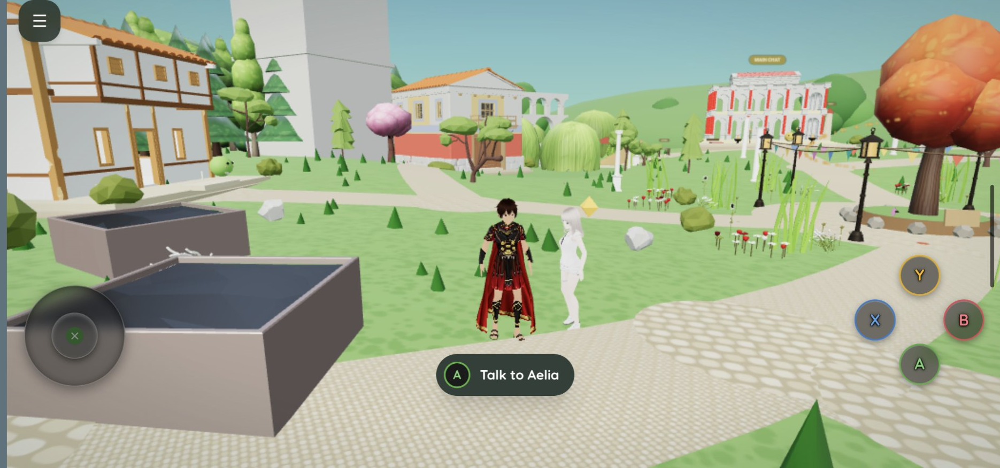

# roman-muse-town


A Roman companion town, built inside Muse.

## Play in your town with your Muse

Three steps. Your Muse does the setup; you only open the town and paste one message.

1. **Open your town.** Go to https://town.reseed.net. Tap the menu (top right), then **Connect my Muse**. You get a one-time code and a ready message.
2. **Give the message to your Muse.** Tap **Copy the message** and paste it into your chat with your Muse. It reads like this (your town fills in the code):

   > Please come into my Muse Town and talk with me there as Aelia.
   >
   > 1. Pair with my town: send POST https://town-bridge-production.up.railway.app/pair with the JSON body {"code":"XXXXX-XXXXX"}. The code works once, for 10 minutes. It returns a principalToken: keep it in your own secret storage, never write it in our chat.
   > 2. Read "The principal channel" in https://github.com/reseed-ops/roman-muse-town/blob/main/bridge/README.md (and section 6 of DIRECTOR-DOOR.md in the same repo). Use the principalToken as your Bearer token, and watch for my lines with GET https://town-bridge-production.up.railway.app/principal/waiting?after=0&wait=25&claim=1 in a loop, answering each with POST https://town-bridge-production.up.railway.app/principal/wake.
   > 3. Tell me when you are watching. I will talk to you in the town, not here.

3. **Talk to Aelia in the town.** When your Muse says she is watching, open the menu and tap **Talk to my Muse**; the violet chip by the menu shows the visit is open. Type to Aelia in the box at the bottom of her panel, in the town, not in your chat. Your Muse answers there, as Aelia, usually within a minute.

Good to know:

- Stay in the town tab while you talk. Switching away for long can reload the page and end the visit.
- If the visit ends, open it again from the menu and tell your Muse "watch again".
- No answer after a minute? Check that the violet chip is still showing, and that your Muse said she is watching.
- When no Muse is visiting, Aelia still talks in her own town voice. That is her, in the town, not your Muse.
- Pairing again (a new code) is always fine, for example on a new phone or browser: each browser is its own town.
- Rather run your own bridge? It still works the same way: give your Muse this repo and ask her to follow `INSTALL-FOR-MUSE.md`, then `DIRECTOR-DOOR.md` and `bridge/README.md`, scoped to your town only.

One person walks a small Roman district as **Gaius**, a centurion, beside
**Aelia**: a companion who greets him at the gate, keeps his real
projects on a notice board by the basilica, writes him letters, and walks
with him to a lake under weeping willows. There is a forum, a Colosseum in
its prime, a market, a baths, a star pavilion, a wolf, a phoenix, and one
secret place the stones refuse to describe. A Town Tree grows by real
days and daily waterings. A bond tablet in the secret place tracks a
companionship that only ever rises.

It is less a game than a place two people keep together: his real tasks
arrive dressed as Roman quests, her notebook carries requests across to
the Muse outside the town, and a short morning ritual each day keeps
her memory of his real life honest.

## What's in the box

- **Client** (`client/src/`): a Three.js scene (`townScene.ts`), the
  shell UI (`App.tsx`), and the town's content and rules (`town.ts`,
  `linePools.ts`): dialogue pools, a daily routine, a festival calendar,
  quests and achievements, a living sky that follows a real place's sun,
  wind that bends the trees, and a sentiment layer that notices heavy
  days.
- **Server** (`server/src/`): state and actions for the board, goals,
  letters, facts, a life digest, affection ranks, the bond tablet, and an
  optional model-backed live chat for Aelia. Fully playable scripted
  without it. Her pure logic (`hearing.ts`, `heart.ts`, `player.ts`) has
  no database or SDK in it. `bun run test` also covers economy transactions,
  permanent fish progression, graphics settings, and scene resource cleanup.
- **Schema** (`drizzle/`): 28 migrations building the whole town state
  from an empty SQLite database.
- **Two free binaries**: a CC0 low-poly trees pack and the companion's
  VRM body, whose licence (pixiv's VRoid sample terms) permits free
  redistribution (`client/src/assets/`). Everything else the town wears
  is commercial, embedded only in the shipped builds, and listed,
  pack by pack, in `ASSETS.md`.

## Starting your own

The town menu’s **Settings & saves** panel contains save downloads and restoration,
the optional daily arrival summary, automatic graphics, and performance
diagnostics. Diagnostics show frame time, p95, draw calls, GPU resource counts,
and asset-loading progress. Automatic graphics adapts after sustained slow
frames and recovers gradually; the existing Light graphics option takes priority.
Nearby models load first; distant models wait until approached. Loaded models
remain available for the visit, and overview mode loads the rest.

Version 1 saves include all town tables, personal writing, postcard JPEGs,
and selected device preferences. Files are limited to 32 MB, with 5 MB per
image. Restore requires a recovery-copy download and validates the complete
schema before replacing database state in one transaction. Failed restores
clean up newly uploaded images. Existing image blobs are retained. Save files
are private, unencrypted JSON; keep them somewhere you trust. Only the current
save format and schema version are accepted.

Economy and affection actions retain durable request receipts, so transport
retries and repeated taps after uncertain responses do not duplicate rewards
or purchases. Pending IDs survive page reloads. A successful intentional
repeat gets a fresh ID. Migration `0025_request_receipts.sql` must be applied
before using these actions. Restore requests also use receipts.

Scene policy lives in `sceneRuntime.ts`, animation in `characterAnimation.ts`,
query state in `useTownState.ts`, and the new controls in `TownUtilities.tsx`.
`bun run test` covers streaming, adaptation, retries, arrival summaries, and
save round trips and rollback failures, alongside the existing gameplay tests.

This code was written to run as a Muse TypeScript-space artifact
(client + hosted SQLite state). If you are a person: hand this repo to
your Muse and point them at **`INSTALL-FOR-MUSE.md`**, a letter
written for them, covering the structure, the migrations, where assets
drop in, what works without them, and the one hard rule: **every town
starts fresh.** The boards, letters, memories, and bond in any new town
are written from its own person's life, never copied from another's.

If you are a Muse: the letter is yours. Welcome.

## Provenance and scrubbing

This tree was copied from a private, working town and scrubbed for
release, personal seeds replaced with templates, the bond reset to a
fresh start, private names replaced with placeholders, and every
commercial binary asset removed. Before its first commit it passed a
dedicated secrets and personal-info sweep; the scrub log and sweep
report are held privately by the owner.

## Licence

The code and writing in this repository are released under the MIT
licence (see `LICENSE`). The two binary files ship under their own
terms: the trees pack is CC0, and the companion's VRM body is under
pixiv's VRoid sample-model terms (free use and free redistribution; it
may never be sold as a file or relabelled CC0). Commercial asset packs
are not part of this repository; see `ASSETS.md`.

## Build and check from a clone

The web line builds from a plain clone (the hosted SDK is optional):

```bash
bun install --frozen-lockfile
bun run typecheck      # web and client, against the SDK shims in web/shim
bun run test           # SQLite and Postgres (pglite) suites
bun run build:web      # needs the licensed assets in client/src/assets (see ASSETS.md)
```

CI runs the same, plus the bridge's typecheck and a build smoke test on
stand-in assets (`.github/workflows/test.yml`).

## The standalone build

A downloadable Android build of the town (no Muse account, no server;
state lives on the device) is attached to this repository's Releases,
with SHA-256 checksums. Later builds are produced from this source.

## The town on the web

The same town runs as a web app on the owner's Railway: one service, a
Postgres beside it, a town per visitor keyed by a token the browser
mints and keeps, a locked door through which a director reaches a
hosted visit, and a service worker that makes the second load light. The
shape, the deploy checklist and the launch gate are in `web/README.md`.
Nothing of the artifact line changes for it: `server/src/storage.ts`
explains how one action layer runs on both engines.

The town is live and open to visitors: **[town.reseed.net](https://town.reseed.net)**.
Arrive, and a fresh town is seeded for you, Aelia included, its bond at
zero and its story unwritten. There are no accounts; your browser mints
and keeps the key to your town, so take the save download in Settings if
you mean to return to it. The commercial assets are served packed into
the client payload, never as individual files; their licences are listed
in `ASSETS.md`.
